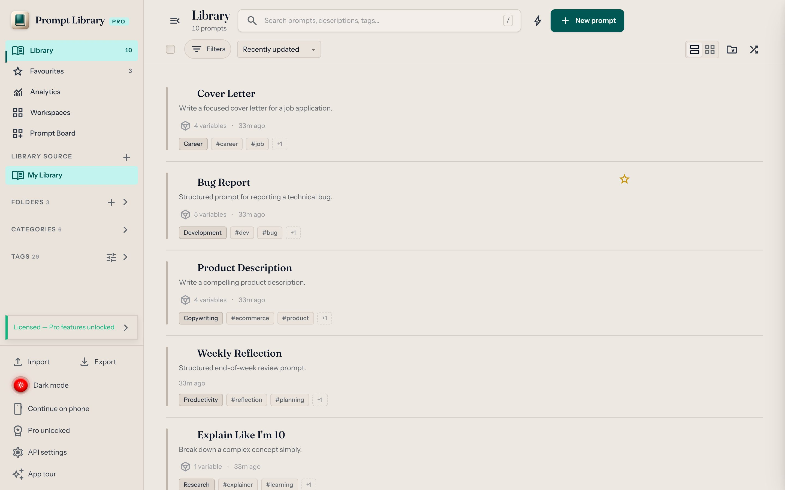
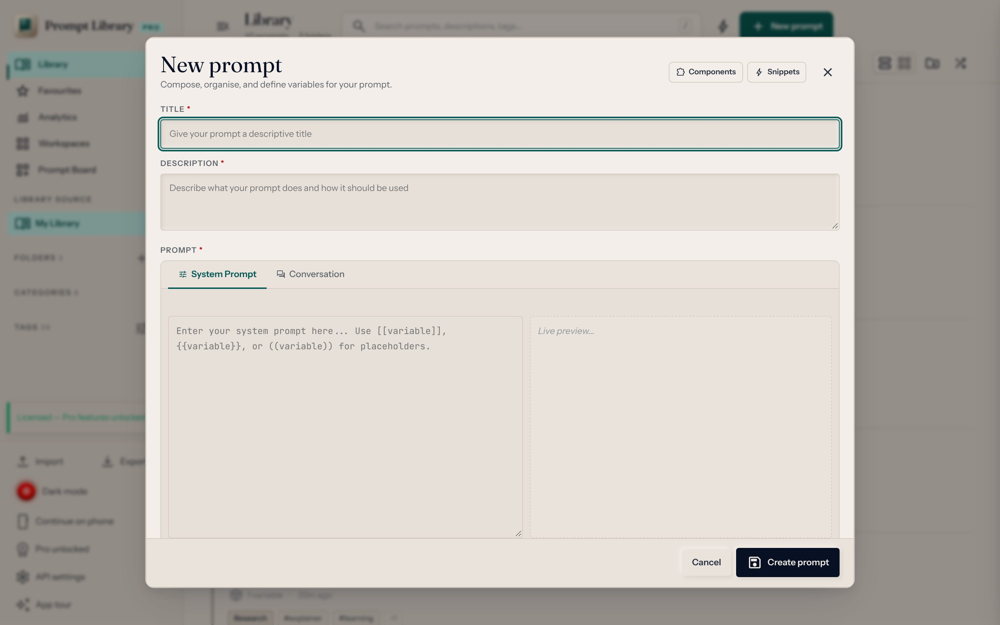
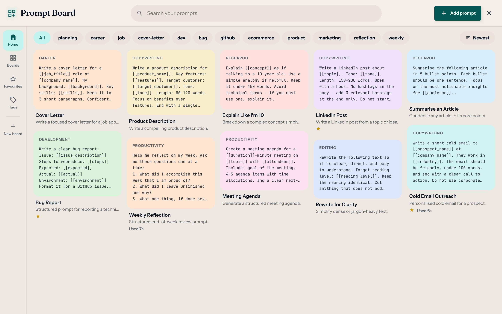

# Prompt Library Pro

**A local-first workspace for building, organising, testing and reusing AI prompts.**

Prompt Library Pro brings prompt libraries, reusable variables, AI personas, prompt workflows and specialist prompt engineering tools into one desktop application. It is designed for people who treat prompts as working assets and want a consistent place to develop and manage them.

The application runs locally on your computer. Your prompt library is stored in a local SQLite database rather than a hosted Prompt Library account.



[Browse the full interface showcase](showcase/index.html)

## What it does

### Prompt library

- Create, edit, duplicate and organise prompts.
- Use folders, categories, tags, colours and favourites to keep a library manageable.
- Search and filter prompts.
- Add reusable variables to prompt templates, including `[[variable]]`, `{{variable}}` and `((variable))` formats.
- Preview and copy prompts with their variable values filled in.
- Import and export prompt collections, including Prompt Library Pack (`.plp`) files.

### Roles and AI personas

Create reusable roles with their own instructions, expertise, tone, skills and supporting knowledge. Attach roles to prompts and reuse them across your workflow.

### Prompt workflows and workspaces

The application includes specialist workspaces for prompt creation and development. Depending on the current build and licence level, these include:

- **Prompt Forge and Prompt Builder Pro**, structured prompt creation and component based building.
- **Prompt Components**, a library of reusable prompt building blocks.
- **Prompt Chains**, a way to organise prompts into a multi step workflow.
- **Playground and Prompt Lab**, spaces for working with prompts and comparing variations.
- **Prompt Optimizer and Tone Calibrator**, tools for reviewing and refining prompt quality and style.
- **Context Bank and Snippets**, reusable context and text blocks.
- **Prompt Board**, a visual way to collect prompts into boards.
- **Agents and Roles**, reusable AI identities and instructions.
- **Analytics and version history**, tools for reviewing usage and previous prompt versions.

Some advanced workspaces and features are licence gated. The exact feature set can change between builds.

### Local data and portability

- Prompt data is stored in a SQLite database in your Documents folder, under `PromptLibrary`.
- Prompt collections can be exported and imported.
- The application does not require a Prompt Library cloud account.
- Optional AI features connect to the provider you configure. Those requests are sent to that provider, so they are not offline operations.

## Screenshots

The repository includes a screenshot gallery with light and dark interface captures.

| Library | Prompt editor | Prompt Board |
| --- | --- | --- |
|  |  |  |

More screenshots are available in the [showcase gallery](showcase/index.html).

## Installation

### Windows

If you have a packaged installer supplied by the project maintainer, run the installer and follow its instructions.

To run the application from source:

1. Install Python 3.9 or later.
2. Install the Microsoft Edge WebView2 Runtime if it is not already available on your system.
3. Download or clone this repository.
4. Open a terminal in the repository folder.
5. Run `start.bat`.

The start script creates a virtual environment if required, installs the pinned Python dependencies and launches the desktop application.

You can also run the steps manually:

```powershell
python -m venv venv
.\venv\Scripts\Activate.ps1
python -m pip install -r requirements.txt
python Main.py
```

If PowerShell prevents activation, use the supplied `start.bat` instead.

### macOS

The repository contains an early macOS packaging configuration in `mac/setup.py`. Building a macOS application must be done on macOS and requires the relevant packaging tools, including `py2app`.

The macOS packaging path is not documented as a supported end user release process yet. The Windows launch and installer scripts are the primary documented workflow.

## Building a Windows executable

The project includes a PyInstaller build script and an Inno Setup installer definition.

1. Use a Windows development machine.
2. Install Python 3.9 or later.
3. Install Inno Setup 6.3 or later.
4. Run `Build.bat` from the repository root to build the executable.
5. Open `PromptLibrary.iss` in Inno Setup and compile the installer.

The executable is written to `dist/PromptLibrary.exe`. The installer output is written to the `installer` folder.

The build scripts may update generated cache identifiers and remove previous build output. Review local changes before committing after a build.

## Technology

| Area | Technology |
| --- | --- |
| Desktop shell | PyWebView |
| Local web application | Flask |
| Production WSGI server | Waitress |
| Backend language | Python |
| Frontend | HTML, CSS and vanilla JavaScript |
| Local storage | SQLite |
| Windows executable | PyInstaller |
| Windows installer | Inno Setup |
| macOS packaging configuration | py2app |

There is no Node.js or npm build step in the current frontend workflow.

## Repository layout

```text
.
├── Main.py                 Desktop application launcher
├── app.py                  Flask application and API
├── share_server.py         Local network sharing service
├── vault_scanner.py        Local Markdown vault scanner
├── requirements.txt        Pinned Python dependencies
├── start.bat               Windows development launcher
├── Build.bat               Windows executable build script
├── BUILD_INSTALLER.bat     Windows installer build workflow
├── PromptLibrary.iss       Inno Setup installer definition
├── static/
│   ├── index.html           Application interface
│   ├── app.js               Main frontend logic
│   ├── app.css              Main frontend styles
│   └── ...                  Workspace modules and assets
├── mac/                     macOS packaging configuration
├── docs/                    Product and development documentation
├── showcase/                Interface screenshot gallery
├── tests/                   Automated test files
└── _rollbacks/               Historical rollback copies
```

The repository also contains development notes, product specifications, build history and archived versions. These are maintained for project development and are not all required to run the application.

## Python dependencies

The pinned runtime dependencies are listed in `requirements.txt`:

- Flask
- PyWebView
- Waitress

The Windows executable build additionally installs PyInstaller. The macOS packaging configuration uses py2app.

## Data, privacy and AI provider connections

Prompt Library Pro is designed around local storage. Its main prompt database is stored at:

```text
Documents/PromptLibrary/PromptLibrary.db
```

Back up this folder before reinstalling the application, moving to another computer or testing development builds.

The application can connect to external AI providers when the user configures provider credentials. In that case, the relevant prompt or request is sent to the selected provider for processing and is subject to that provider's own terms and privacy policy. Local-first does not mean that external AI requests are processed offline.

Do not commit API keys, licence key files, personal databases or other private data to this repository.

## Development notes

- Start the application with `start.bat` on Windows.
- Run Python syntax checks with `python -m py_compile app.py Main.py vault_scanner.py share_server.py`.
- Check frontend JavaScript syntax with `node --check static/app.js` when Node.js is available.
- Review `DEPLOYMENT_CHECKLIST.md`, `LICENCE_SYSTEM.md` and the files in `docs/` for additional implementation notes.
- The `_rollbacks/` directory contains historical copies. Do not use those files as the current application entry points.

The repository is actively developed. Features, licensing tiers, screenshots and build instructions may change as the application evolves.

## Licence

The repository currently includes an MIT licence in the root `LICENSE` file. That licence permits use, modification and redistribution subject to its stated conditions.

**The MIT licence already published with this repository cannot be treated as though it never existed.** Copies obtained under that licence remain subject to the MIT terms that accompanied them. Any future licensing change must also account for third party components, contributions and their respective rights.

See [LICENSE](LICENSE) for the licence text.

## Project

**Prompt Library Pro**  
Product information: [MX Phillips on Payhip](https://payhip.com/MXPhillips)  
Source repository: [funben12/Prompt-Library-Update](https://github.com/funben12/Prompt-Library-Update)
